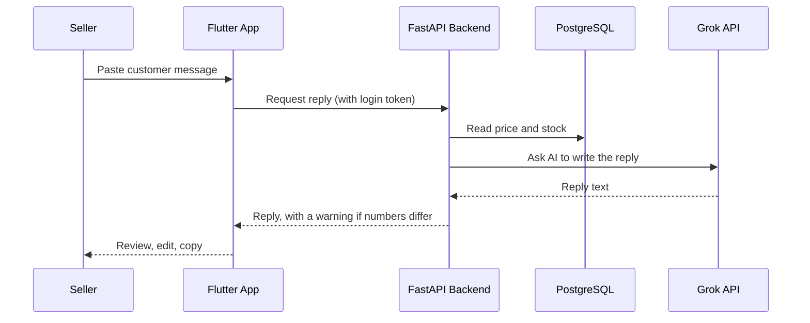

<div align="center">

# ReplyPilot AI: Android App

**An Android app that helps Facebook sellers in Bangladesh reply faster and keep track of customers, orders, stock and follow-ups.**


[**Download APK**](https://github.com/sumaiya-akter-runa/ReplyPilot_AI/releases/latest) 
</div>

---

## Overview

Thousands of small businesses in Bangladesh sell through Facebook pages, and their owners answer the same questions all day: *"What is the price?"*, *"Is size M available?"*, *"How much is delivery?"*

ReplyPilot reads the seller's own products, prices and stock, and writes a ready-to-send reply in Bangla, Banglish or English. The seller reviews, edits and sends it on Messenger.

> **Prices and stock come from the database. The AI only writes the language.**
> The app never sends messages by itself. The seller always has the final say.

This repository contains the **Flutter app**. The API is in the [backend repository](https://github.com/sumaiya-akter-runa/ReplyPilot_Backend).

## Features

| Screen | What it does |
|---|---|
| **Login / Register** | Sign up and log in, token stored securely on the phone |
| **Home** | Today's new customers, orders and sales, plus AI usage this month |
| **Reply Studio** | Paste a customer message, choose language and tone, get a reply, refine it with one tap (shorter, friendlier) |
| **Customers** | Add, search and filter by status: new, interested, follow-up, ordered, lost |
| **Customer detail** | Message history, status chips, reminder presets, quick Reply, Follow-up and Order buttons |
| **Follow-up reminders** | Customers whose reminder day has come, with an AI-drafted follow-up message |
| **Orders** | Order list and status updates, cancel restores stock, delete |
| **Order builder** | Pick products and sizes, fill customer details from a message |
| **Products** | Product form with size variants, stock and low-stock threshold |
| **FAQs** | Saved answers for common questions |
| **Business setup** | Shop details and default reply language |
| **AI usage** | Monthly usage and limit |
| **Help** | Built-in guide in English and Bangla |

## How a Reply Is Made



## Screenshots

| Home | Reply Studio | Customers |
|:---:|:---:|:---:|
|  |  |  |

| Orders | Follow-up | Products |
|:---:|:---:|:---:|
|  |  |  |

## Install the App

1. Open the [latest release](https://github.com/sumaiya-akter-runa/ReplyPilot_AI/releases/latest) and download `app-release.apk`
2. Open it on an Android phone (allow *Install from unknown sources* if asked)
3. Register, add your products and start replying

> The server may take up to a minute to respond on the first request after being idle.

## Run from Source

### Requirements
- Flutter SDK
- Android Studio or VS Code
- An Android phone or emulator

### Steps

```bash
git clone https://github.com/sumaiya-akter-runa/ReplyPilot_AI.git
cd ReplyPilot_AI
flutter pub get
flutter run --dart-define=API_BASE_URL=https://replypilot-backend-recc.onrender.com
```

### Backend address

Set in `lib/core/config.dart`, and can be overridden with `--dart-define`:

| Where the backend runs | `API_BASE_URL` |
|---|---|
| Deployed server | `https://replypilot-backend-recc.onrender.com` |
| Android emulator | `http://10.0.2.2:8000` |
| Real phone, backend on your PC | `http://<your-pc-ip>:8000` (same Wi-Fi) |

### Build the APK

```bash
flutter build apk --release
```

Output: `build/app/outputs/flutter-apk/app-release.apk`

## Project Structure

```
lib/
├── core/
│   ├── api.dart            API methods (customers, orders, products, AI)
│   ├── api_client.dart     HTTP client, token handling, errors
│   ├── config.dart         Backend base URL
│   ├── theme.dart          App theme
│   └── token_store.dart    Saves the login token
├── models/
│   └── models.dart         Data models
├── screens/                All app screens
├── widgets/
│   ├── common.dart         Shared widgets, status chips, dialogs
│   └── followup_sheet.dart Follow-up draft bottom sheet
├── providers.dart          Riverpod providers
└── main.dart               App entry point
```

## Tech Stack

| Layer | Technology |
|---|---|
| App | Flutter, Dart |
| State management | Riverpod |
| API calls | Dio |
| Secure token storage | Flutter Secure Storage |
| Backend | FastAPI, SQLAlchemy, Pydantic |
| Database | PostgreSQL (Neon) |
| Security | JWT, Argon2 |
| Deployment | Docker, Render |
| AI | Groq API |

## Design Decisions

- **No auto-send.** The seller reviews every message before it goes out.
- **The AI never decides numbers.** Price and stock come from the database, and replies with mismatching numbers are flagged.
- **Rules live on the server.** Stock updates and the monthly AI limit are enforced by the backend, so the app cannot skip them.
- **Bilingual help.** Key screens include short Bangla hints.

## Known Limitations

- Messenger is not connected yet, so customer messages are pasted manually
- No push notifications for follow-ups
- The free server may take up to a minute to wake after being idle
- Android only

## Future Work

- Messenger webhook so customer messages arrive automatically (needs Meta App Review for real customers)
- Push notifications for follow-up reminders
- Share-to-app from Messenger

## Author

**Sumaiya Akter Runa**
